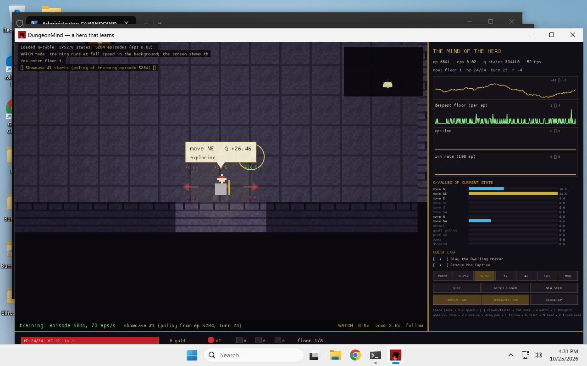
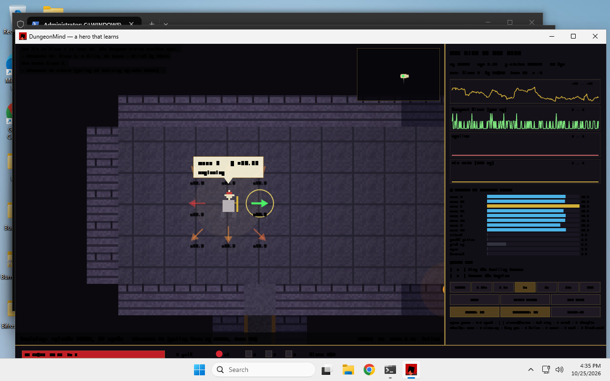
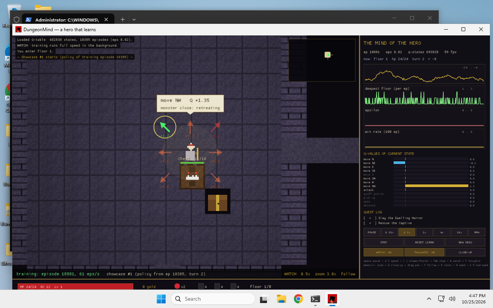
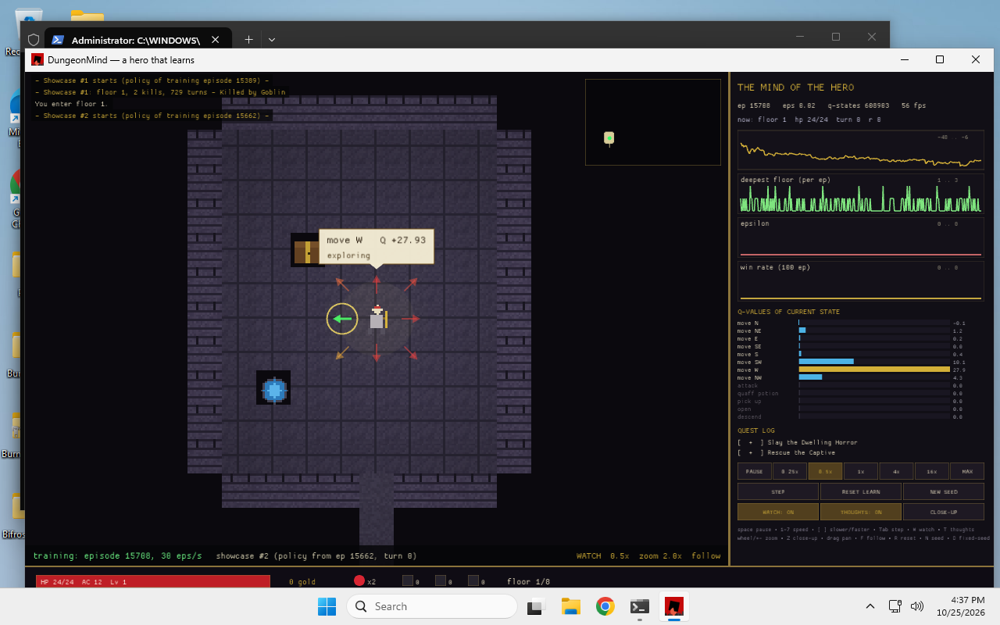
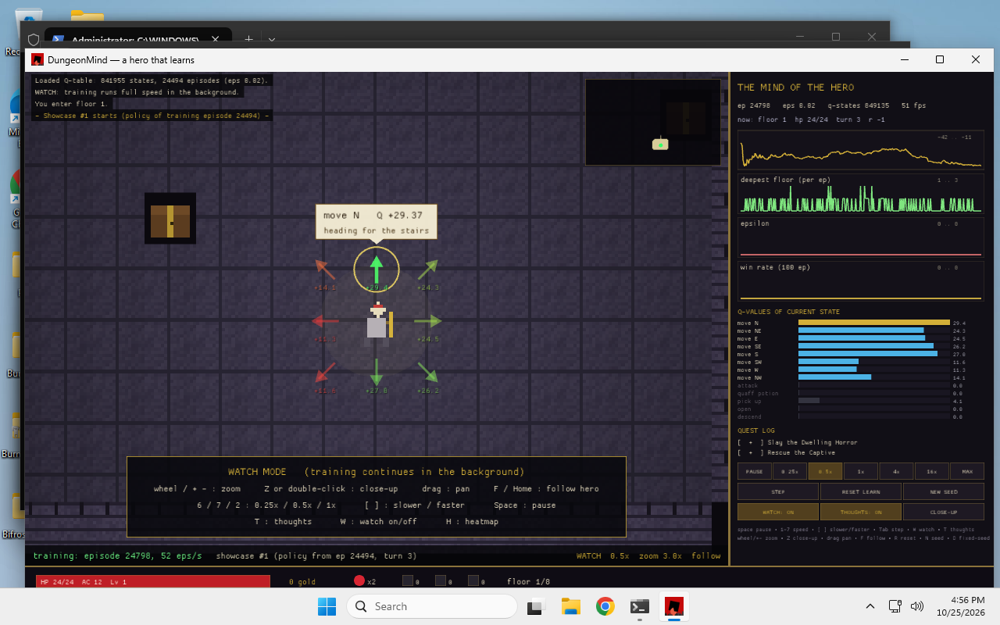
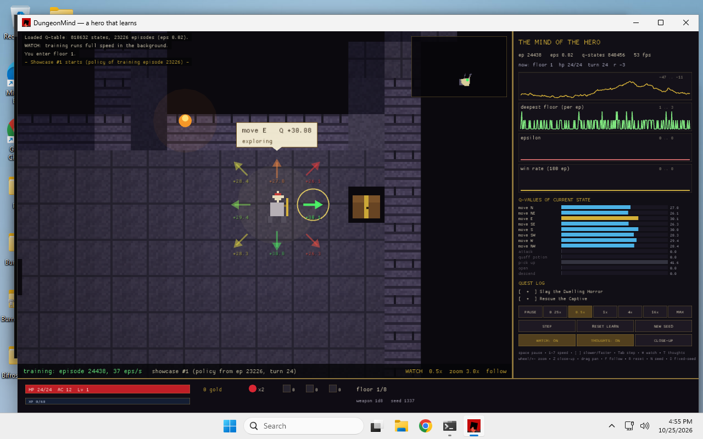

# DungeonMind (Rust)

[](LICENSE)
[](https://github.com/charles-forsyth/dungeonmind-rs/releases/latest)
[](https://www.rust-lang.org)
[](https://charles-forsyth.github.io/dungeonmind-rs/)

A self-playing, self-learning roguelike dungeon crawler written in **Rust** with [macroquad](https://github.com/not-fl3/macroquad). The hero is an autonomous tabular **Q-learning** reinforcement learning agent: watch it explore procedurally generated dungeons, battle monsters, evaluate action utilities, and become measurably smarter episode after episode.

All visual assets and pixel art are procedurally generated at startup (16×16 pixel sprites with zero external sprite sheets).

> **Web Version**: Looking for the original TypeScript/web version? Check out [charles-forsyth/DungeonMind](https://github.com/charles-forsyth/DungeonMind). This repository is the native desktop Rust reimplementation featuring high-throughput training, headless simulation, and real-time reinforcement learning diagnostics.

---

## Screenshots

| AI Decision Overlay ("Thoughts") | Real-time Combat & Dice Rolls |
| :---: | :---: |
|  |  |

| Mimic Encounter & Q-Values | Episode Recap & Analytics |
| :---: | :---: |
|  |  |

| Tactical Decision Hints | Door & Quest Progression |
| :---: | :---: |
|  |  |

---

## Features

- **Tabular Q-Learning Agent**: Full $\epsilon$-greedy reinforcement learning algorithm with geometric exploration decay, reward shaping, and state space persistence (`%LOCALAPPDATA%\DungeonMind\qtable.bin`).
- **Concurrent Watch Mode**: Background multi-threaded engine trains the agent at 50–100+ episodes/sec while periodically publishing immutable policy snapshots to a 60 FPS showcase frontend.
- **Deep Cognitive Visualization**:
  - Live thought bubbles displaying the selected action, expected return ($Q$), and heuristic rationale (*"monster close: retreating"*, *"heading for the stairs"*, *"exploring"*).
  - 8-directional action vectors color-coded by expected utility (red to green).
  - Real-time action distribution bar chart comparing all 13 discrete candidate actions.
  - Performance graphs: reward curve, 100-episode moving average, deepest floor reached, exploration rate ($\epsilon$), and win rate.
- **Procedural Roguelike Engine**: 8 seeded dungeon floors (120×80 tiles) featuring rooms, corridors, traps, secret passages, healing shrines, locked doors with key puzzles, and 13 D&D-inspired monster archetypes with d20 combat rolls.
- **Portable & VM-Ready**: Release archives include Mesa llvmpipe software OpenGL fallback (`opengl32.dll`) enabling smooth execution even in GPU-less virtual machines or cloud environments.

---

## Download & Installation

Standalone release builds for Windows are available on the [Releases page](https://github.com/charles-forsyth/dungeonmind-rs/releases/latest):

| Architecture | Release Archive | Target Hardware |
| :--- | :--- | :--- |
| **ARM64** | `DungeonMind-arm64.zip` | Qualcomm Snapdragon X Elite/Plus, Surface Pro ARM, Windows ARM64 VMs |
| **x64** | `DungeonMind-x64.zip` | Intel & AMD 64-bit PCs |

### How to Run
1. Download the zip file corresponding to your architecture.
2. Extract the archive into a folder. **Keep `opengl32.dll` in the same directory as `DungeonMind.exe`**.
3. Double-click `DungeonMind.exe`.

> **Windows SmartScreen Notice**: DungeonMind is an open-source project and is not signed with a paid commercial code-signing certificate. Windows SmartScreen may show a prompt saying *"Windows protected your PC"*. Click **More info** and then **Run anyway**.

---

## Controls & Hotkeys

| Key / Input | Action |
| :--- | :--- |
| `Space` | Pause / resume simulation |
| `Tab` | Step exactly one hero turn (or skip episode recap) |
| `1` – `7` | Speed presets: Pause, 1x, 4x, 16x, Max, 0.25x, 0.5x |
| `[` / `]` | Decrease / increase simulation speed |
| `Mouse Wheel` / `+` / `-` | Smooth zoom in/out (from full floor view to 4x close-up) |
| `Z` / `Double Click` | Snap to close-up Watch zoom (3.0x) tracking hero |
| `Mouse Drag` | Pan camera manually |
| `F` / `Home` | Re-center and follow the hero |
| `W` | Toggle Watch mode (Showcase vs direct learner) |
| `T` | Toggle Thought bubbles and directional Q-value vectors |
| `H` | Cycle heatmap overlay: off / visits / explored |
| `R` | Reset learning (wipe Q-table and restart from zero) |
| `N` | Generate a new random dungeon seed |
| `D` | Toggle fixed-seed vs new-seed-per-episode mode |
| `S` | Force save Q-table to disk |

---

## Command Line Arguments

```bash
# Launch GUI in default Watch mode (0.5x speed, 3x zoom)
DungeonMind.exe

# Start with specific speed or zoom preset
DungeonMind.exe --speed 4 --zoom 3.0

# Headless training: train for 5,000 episodes and print summary metrics
DungeonMind.exe --train 5000 --seed 42

# Fast headless evaluation run
DungeonMind.exe --headless
```

---

## Reinforcement Learning Architecture

1. **State Observation (`World::build_obs`)**:
   A compact discrete representation encoding:
   - 3×3 surrounding tile bitmask (walls, doors, water, traps)
   - Nearest visible monster type, distance bucket, and 8-sector relative direction
   - Current hero HP percentage bucket
   - Key matching inventory status for visible doors
   - Stairs proximity and current floor index (1 to 8)
2. **Action Space (13 discrete actions)**:
   - Move N, NE, E, SE, S, SW, W, NW
   - Attack
   - Quaff healing potion
   - Pick up item / key
   - Open door / chest
   - Descend stairs
3. **Reward Function (`src/sim_act.rs`)**:
   - Small step penalty to discourage endless looping
   - Positive rewards for exploring new tiles, unlocking doors, collecting keys, defeating enemies, and descending floors
   - Heavy penalties for taking damage and dying

---

## Building from Source

### Prerequisites
- [Rust toolchain](https://rustup.rs/) (1.75+)
- On Linux: `sudo apt-get install libx11-dev libxi-dev libgl1-mesa-dev`

### Commands
```bash
git clone https://github.com/charles-forsyth/dungeonmind-rs.git
cd dungeonmind-rs

# Run simulation test suite
cargo test --test sim

# Run GUI locally
cargo run --release

# Cross-compile for Windows (if toolchain installed)
cargo build --release --target x86_64-pc-windows-msvc
cargo build --release --target aarch64-pc-windows-msvc
```

---

## Citation

If you use DungeonMind in research on reinforcement learning in games or procedural environments, please cite as follows:

```bibtex
@software{forsyth2026dungeonmind,
  author       = {Forsyth, Charles E. III},
  title        = {DungeonMind: Self-Learning Q-Learning Roguelike},
  year         = {2026},
  publisher    = {GitHub},
  version      = {0.1.0},
  url          = {https://github.com/charles-forsyth/dungeonmind-rs},
  note         = {DOI: pending}
}
```

See [`CITATION.cff`](CITATION.cff) for complete CFF 1.2.0 metadata.

---

## License

This project is licensed under the [MIT License](LICENSE). Copyright (c) 2026 Charles Forsyth.
